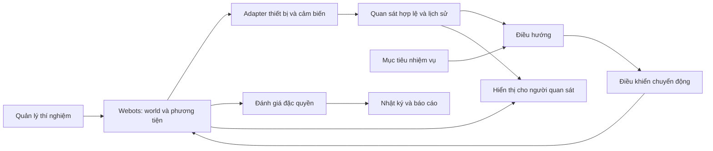

# Kiến trúc hệ thống

Trạng thái: đã có bản thử Webots v1 cho điều khiển thủ công, cảm biến, va chạm và reset. Xem [hướng dẫn](../lab-v1.md) và [kế hoạch/bằng chứng](../plans/0002-webots-minimal-lab.md). Chưa có kết quả huấn luyện hoặc điều hướng tự động.

## Mục tiêu và nguyên tắc

Một drone mô phỏng thực hiện nhiệm vụ mức B: đến đích được cấp, tránh vật cản tĩnh, quan sát không camera. Webots là nền tảng khảo sát đầu tiên. Các chi tiết dừng ở đích, chuyển động, cảm biến và ngưỡng chất lượng vẫn là dự thảo.

Webots sẽ giữ trạng thái vật lý có thẩm quyền khi tích hợp. Core Python chứa hợp đồng, thuật toán và logic thí nghiệm độc lập simulator; không nhân đôi trạng thái vật lý như một thế giới thật thứ hai.

## Luồng dữ liệu

Luồng từ trạng thái thật sang bộ đánh giá/hiển thị không được quay lại bổ sung đầu vào cho điều hướng. Các nhãn huấn luyện hoặc reward tạo từ ground truth phải ở đường huấn luyện riêng và không là quan sát runtime.

## Trách nhiệm và thư mục

| Phần | Thư mục | Trách nhiệm |
|---|---|---|
| Hợp đồng | src/blind_drone/contracts | Cấu trúc dữ liệu, đơn vị, frame và quyền truy cập |
| Môi trường | src/blind_drone/world | Đặc tả/generator tình huống; tạo trạng thái ban đầu |
| Phương tiện | src/blind_drone/vehicle | Đặc tả khả năng và giới hạn phương tiện |
| Cảm biến | src/blind_drone/sensors | Mô hình quan sát và chính sách lấy mẫu |
| Quan sát | src/blind_drone/observation | Đóng gói dữ liệu hợp lệ, lọc/ước lượng và lịch sử |
| Điều hướng | src/blind_drone/navigation | Mục tiêu + quan sát → yêu cầu di chuyển |
| Điều khiển | src/blind_drone/control | Yêu cầu di chuyển → hành động phù hợp phương tiện |
| Đánh giá | src/blind_drone/evaluation | Kết thúc lượt, chỉ số, ground truth dùng để chấm |
| Thí nghiệm | src/blind_drone/experiments | Cấu hình, seed, chia tập, chạy và provenance |
| Hiển thị | src/blind_drone/visualization | Lớp giải thích quan sát và diễn biến |
| Adapter | src/blind_drone/adapters/webots | Truy cập API Webots và chuyển đổi dữ liệu/frame |
| Huấn luyện | src/blind_drone/training | Tích hợp trainer sau khi môi trường được xác minh |

## Quy tắc phụ thuộc

- contracts không phụ thuộc Webots hoặc framework học máy.
- navigation không import world, evaluation, visualization hoặc adapter có quyền truy cập scene.
- observation nhận bản tin cảm biến cho phép, không nhận toàn cảnh.
- adapter là biên API simulator; controller drone và supervisor có quyền khác nhau.
- experiments kết nối các phần nhưng không đưa dữ liệu đặc quyền vào policy.
- training có thể dùng teacher/nhãn riêng; student runtime nhận cùng hợp đồng quan sát được đánh giá.
- Những ràng buộc này hiện là thiết kế; cần kiểm tra tự động luồng dữ liệu khi có runtime.

## Các bước bằng chứng

1. Scaffold: cấu trúc/config/link hợp lệ.
2. Simulator: world, phương tiện, cảm biến và va chạm thực sự chạy.
3. Baseline: nhiệm vụ và bộ đánh giá hoạt động.
4. Model: huấn luyện, kiểm tra trên tình huống chưa học, so sánh ghép cặp.
5. Hardware: nếu mở rộng sau này, cần bằng chứng riêng.

Không dùng kết quả của bước trước để tuyên bố hoàn thành bước sau.
