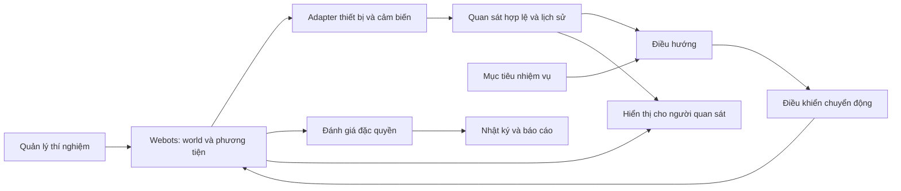

# Kiến trúc hệ thống

Hiện trạng sau DATA-04 (2026-10-29): [README](../../README.md) và [checklist](../../CHECKLIST_DU_AN.md) là điểm vào tiến độ hiện tại. V3 đóng bằng validation âm; v4/DATA-03/04 chỉ hoàn tất development. [0017](../plans/0017-maintenance-and-retention-audit.md) là bảo trì/offline; [0018](../plans/0018-retention-study-proposal.md) còn dự thảo. Kiến trúc và runtime frozen bên dưới không thay đổi trong đợt này.

Trạng thái: Webots v1, baseline và đánh giá nhiệm vụ đã chạy thực. Giai đoạn [môi trường có seed/protocol khóa](../seeded-environments-v1.md) hoàn tất 48 lượt paired trên CI; xem [báo cáo và giới hạn](../research/2026-10-26-seeded-environments.md). Chưa huấn luyện model.

Giai đoạn [v2](../navigation-v2.md) thêm grid từ phép đo, hull guard và planner trên grid tự đo, kiểm chứng 108 lượt theo protocol riêng. World thật/witness không cấp cho planner. V1 runtime giữ nguyên; v2 là các module versioned cạnh nó. [Bằng chứng và chi phí](../research/2026-10-26-navigation-v2.md).

## Mục tiêu và nguyên tắc

Một drone mô phỏng thực hiện nhiệm vụ mức B: đến đích được cấp, tránh vật cản tĩnh, quan sát không camera. Webots là nền tảng khảo sát đầu tiên. Các chi tiết dừng ở đích, chuyển động, cảm biến và ngưỡng chất lượng vẫn là dự thảo.

Webots giữ trạng thái vật lý có thẩm quyền. Core Python chứa hợp đồng, thuật toán và logic thí nghiệm độc lập simulator; không nhân đôi trạng thái vật lý như một thế giới thật thứ hai. World generator kiểm định geometry/witness offline; không tích phân chuyển động thứ hai hoặc cấp witness cho navigation.

## Luồng dữ liệu

Luồng từ trạng thái thật sang bộ đánh giá/hiển thị không được quay lại bổ sung đầu vào cho điều hướng. Các nhãn huấn luyện hoặc reward tạo từ ground truth phải ở đường huấn luyện riêng và không là quan sát runtime.

## Trách nhiệm và thư mục

| Phần | Thư mục | Trách nhiệm |
|---|---|---|
| Hợp đồng | src/blind_drone/contracts | Cấu trúc dữ liệu, đơn vị, frame và quyền truy cập |
| Môi trường | src/blind_drone/world | Đặc tả/generator tình huống; tạo trạng thái ban đầu |
| Phương tiện | src/blind_drone/vehicle | Đặc tả khả năng và giới hạn phương tiện |
| Cảm biến | src/blind_drone/sensors | Mô hình quan sát và chính sách lấy mẫu |
| Quan sát | src/blind_drone/observation | Đóng gói dữ liệu hợp lệ, lọc/ước lượng và lịch sử |
| Điều hướng | src/blind_drone/navigation | Mục tiêu + quan sát → yêu cầu di chuyển |
| Điều khiển | src/blind_drone/control | Yêu cầu di chuyển → hành động phù hợp phương tiện |
| Đánh giá | src/blind_drone/evaluation | Kết thúc lượt, chỉ số, ground truth dùng để chấm |
| Thí nghiệm | src/blind_drone/experiments | Cấu hình, seed, chia tập, chạy và provenance |
| Hiển thị | src/blind_drone/visualization | Lớp giải thích quan sát và diễn biến |
| Adapter | src/blind_drone/adapters/webots | Truy cập API Webots và chuyển đổi dữ liệu/frame |
| Huấn luyện | src/blind_drone/training | Tích hợp trainer sau khi môi trường được xác minh |

## Quy tắc phụ thuộc

- contracts không phụ thuộc Webots hoặc framework học máy.
- navigation không import world, evaluation, visualization hoặc adapter có quyền truy cập scene.
- observation nhận bản tin cảm biến cho phép, không nhận toàn cảnh.
- adapter là biên API simulator; controller drone và supervisor có quyền khác nhau.
- experiments kết nối các phần nhưng không đưa dữ liệu đặc quyền vào policy.
- training có thể dùng teacher/nhãn riêng; student runtime nhận cùng hợp đồng quan sát được đánh giá.
- Runtime baseline đã có whitelist cấu hình/mission, NavigationObservation tường minh và kiểm tra phụ thuộc API/scene. Đây không thay thế audit toàn bộ đường dữ liệu khi mở rộng module hoặc thêm model.

## Các bước bằng chứng

1. Scaffold: cấu trúc/config/link hợp lệ.
2. Simulator: world, phương tiện, cảm biến và va chạm thực sự chạy.
3. Baseline: nhiệm vụ và bộ đánh giá hoạt động.
4. Model: huấn luyện, kiểm tra trên tình huống chưa học, so sánh ghép cặp.
5. Hardware: nếu mở rộng sau này, cần bằng chứng riêng.

Không dùng kết quả của bước trước để tuyên bố hoàn thành bước sau.

## Runtime v3 — development và provenance

[Mốc 7A](../research/2026-10-28-cadence-v3-development.md) bổ sung adapter/world/entrypoints riêng, acquisition-time observation và evaluator physics-tick. [Hướng dẫn](../runtime-v3.md) mô tả luồng dữ liệu và hai tầng khóa. 240 lượt development local và 240 lượt CI kiểm chứng runtime, không thay bằng chứng v1/v2 hoặc cho phép suy ra chất lượng held-out/phần cứng.
