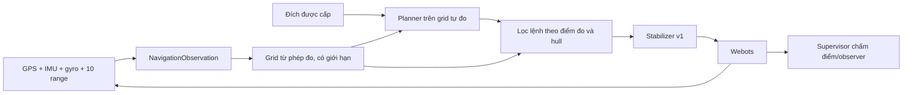

# Quan sát có bộ nhớ và điều hướng v2

Mốc này nghiên cứu lỗi chữ U của v1 bằng ba gói thuật toán không học. [Kế hoạch/tiến độ](plans/0005-observation-and-navigation-v2.md) ghi điều kiện hoàn thành. V1 được giữ nguyên với lock cũ; v2 có adapter, world, launcher và lock riêng.

## Luồng dữ liệu



Planner không nhận geometry/witness/split/ID của supervisor. Nó dùng A* trên grid tự dựng từ range và pose lý tưởng. Đây khác với A* biết toàn bản đồ: ô chưa đo vẫn là unknown, không được coi là free để thực thi chuyển động.

## Ba phương án

- reactive: gọi nguyên BaselineNavigator v1, không tích lũy map hoặc quét chủ động mới.
- guarded: reactive, thêm quét yaw và grid điểm đo, giới hạn lệnh vận tốc hướng vào điểm đã biết theo hull và khoảng thời gian phanh quy ước.
- mapped: cùng phép đo/quét/guard, dùng A* với unknown cost cao hơn free; chỉ thực thi đoạn trước mắt đã đo trống và không bị chặn trong grid inflated.

So sánh reactive→guarded thay nhiều thành phần; không gọi đây là ablation duy nhất của một yếu tố. Guarded→mapped khảo sát gói lập đường trên cùng kiểu biểu diễn/guard, nhưng đường đi và số phép đo thực nhận vẫn có thể khác.

## Bản đồ và ranh giới mô hình

Ray được chiếu từ origin cảm biến bằng toàn bộ roll/pitch/yaw đo được, cập nhật khi có sample timestamp mới. at_limit không tạo endpoint vật cản. Free và occupied tách biệt; occupied được giữ trong thử nghiệm static/ideal này, không có cơ chế xử lý vật cản động hoặc xóa hit sai do nhiễu.

Grid 0.25 m, giới hạn ±12 m quanh pose đầu, tối đa 16000 cell primary (free+occupied). Inflation dùng nửa đường chéo 3D thân, margin và sai số lượng tử cell. Derived blocked cells được báo riêng; số cell không là dung lượng RAM thật. Khi hết budget, navigation yêu cầu dừng. Bản đồ số có thể tiết lộ bố trí không gian; chưa tối ưu dữ liệu hoặc chứng minh quyền riêng tư.

Quét yaw ban đầu 2.5 s và tiếp tục khi di chuyển/không có đoạn đã biết. Vận tốc mới tối đa 0.4 m/s; reactive gốc giữ giới hạn 0.55 m/s. Deadline 90 s áp dụng cả ba. Vì vận tốc khác nhau, cần đọc time/path/collision cùng success, không chỉ so tốc độ về đích.

Guard chỉ xét những bề mặt đã đo và mô hình hull xấp xỉ, không chứng nhận toàn vùng giữa ray hoặc bảo đảm phanh của drone thật. Grid unknown và điểm mù vẫn là giới hạn. Chỉ điều hướng ngang ở goal altitude 1.5 m, cảm biến/actuator lý tưởng v1.

Giới hạn theo mỗi hit: thành phần vận tốc đóng ≤max(0,(khoảng cách tâm đến hit - bán kính guard)/1.4 s). Nó là heuristic trên điểm đo và thời gian đáp ứng quy ước; không dùng trạng thái đặc quyền để đảm bảo phanh. [Chẩn đoán development](research/2026-10-26-v2-diagnostics.md) ghi snapshot timestamp và giới hạn suy luận.

Nếu phép đo mới làm ô hiện tại nằm trong vùng inflation, mapped chỉ lùi/thoát qua đoạn đã đo free và swept disk không chạm các điểm đã biết; endpoint phải ở ngoài vùng chặn và khoảng hở gần nhất không giảm. Recovery tối đa 0.2 m/s, không vô hiệu guard hoặc dùng geometry thật. Nhánh này được kiểm tra bằng unit/contract fixture trước khi chạy lại development; fixture động học tức thời không phải kết quả Webots.

## Chạy

```bash
make check
python3 tools/run_navigation_v2.py --policy mapped --case development-u_trap-s21001 --realtime
```

Cần Webots R2025a và terminal có quyền truy cập desktop/display. Nếu thiếu libGLU.so.1/libsndio.so.7 trên Ubuntu, cài bằng sudo apt install libglu1-mesa libsndio7.0. Trong phiên managed không truy cập được :0, CI dùng Xvfb/software rendering; không báo đó là GUI local đã hoạt động.

CI numeric có thể thêm --no-rendering để tắt observer, không xuất ảnh giả từ lượt đó. Tùy chọn này được [Webots R2025a mô tả chính thức](https://github.com/cyberbotics/webots/blob/R2025a/docs/guide/starting-webots.md). Chạy bỏ cờ này và thêm --realtime để quan sát cùng thuật toán. Planner cache kết quả không có đường chỉ khi đã duyệt hết grid và start/goal/các occupied cells chưa đổi; budget search không bị gọi thành bằng chứng vô nghiệm.

python3 tools/build_navigation_v2.py tạo world/manifest; --check xác minh. Trước khóa chỉ chạy development. --freeze tạo lock lần đầu, từ chối thay lock. Fresh validation/test 51001/51002 và 61001/61002 chỉ chạy khi lock khớp. Development tái dùng 21001/21002 để hồi quy lỗi v1, không là tập unseen.

Lệnh không có --case/--policy chạy đủ ba policy trên 12 case của split. Chọn --split validation hoặc test sau khóa. tools/check_navigation_v2.py nhận ba result.json, kiểm tra đủ 108 lượt/cùng source/protocol, mọi failure và resource counter. Không huấn luyện model ở bước này.

Output trong artifacts/ gồm console, result, failures (snapshot public observation cùng ground truth chấm riêng), trajectories và ảnh. Range sample/value counters là đầu vào observation hợp lệ trong lượt; map updates/cell counts là phần lưu/xử lý. CPU time là trên máy chạy thử, không là latency phần cứng mục tiêu. Thống kê terminal lấy từ telemetry gần nhất, có thể chậm một bước 16 ms.
