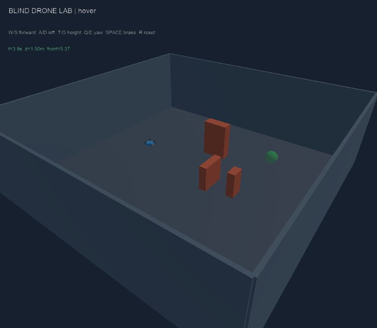

# Kiểm chứng bãi thử Webots v1 — 2026-10-25

Kết quả: world và drone không camera đã chạy qua chuỗi kiểm tra trên Webots R2025a thật trong CI. Đây là bằng chứng về môi trường và điều khiển cơ bản, chưa phải kết quả AI tự điều hướng.

## Nguồn bằng chứng

- Source commit: e1bca4947f169479b578dac8ae3a872971aa59a2.
- [CI run](https://github.com/NguyenPhan161206/Game_Simulator_Lap-Blind_Drone/actions/runs/40205694685).
- [Bản kết quả có cấu trúc](2026-10-25-webots-v1-smoke.json), trích từ result.json của đúng job trên qua GitHub API.
- Ubuntu 22.04, Python 3.12, Xvfb và phần mềm OpenGL; 23.296 giây thời gian mô phỏng, 1455 gói telemetry.
- 13 kiểm tra Python core đạt; 12 mục kiểm tra trong chuỗi simulator đạt.

## Kết quả đo

| Phép kiểm | Kết quả quan sát |
|---|---|
| Hover | Sai lệch vị trí 0.002409 m sau 4 s; độ cao 1.497591 m |
| Tiến | Dịch chuyển x 1.157789 m trong pha lệnh 2 s |
| Phanh | Tốc độ còn 0.057707 m/s sau pha phanh |
| Sang ngang | Dịch chuyển y 0.506910 m |
| Yaw | Thay đổi 0.716984 rad |
| Tăng độ cao | Tăng 0.573874 m |
| Khoảng cách trước | 1.37 m, bằng giá trị hình học fixture |
| Khoảng cách xuống | 1.38 m, bằng giá trị hình học fixture |
| Che khuất | Di chuyển khối bị che không thay đổi mặt chắn gần nhất: 1.37 m |
| Va chạm | Hai contact, tâm drone x=1.386212 m gần vị trí tiếp xúc dự kiến 1.4 m, z=1.5 m |
| Reset | Sai lệch về start 0.013719 m, tốc độ 0.001700 m/s, không còn contact |
| Thiết bị | GPS, IMU, gyro, liên lạc, motor và 10 DistanceSensor; không có Camera |

## Kiểm tra hiển thị

Đã xem ảnh JPEG do supervisor xuất từ CI: mặt đất, tường, ba vật cản, drone và đích đều có trong khung; nhãn hướng dẫn hiện trên ảnh. Trước đó đã phát hiện và sửa lỗi observer dùng nhầm cơ sở camera -Z thay vì +X/FLU của Webots.

Ảnh observer chỉ là đầu ra quan sát, không đưa vào controller drone. PNG/JPEG và telemetry đầy đủ nằm trong artifact webots-smoke-evidence của CI run.

## Những lỗi được tìm và sửa

1. Runner thiếu thư viện âm thanh/XCB: bổ sung các dependency để Webots thực sự mở được, không bỏ qua simulator check.
2. Giới hạn tăng tốc kinematic của motor quá thấp khiến không có lực nâng kịp thời: đặt mô hình actuator phản hồi nhanh và ghi rõ chưa hiệu chỉnh theo motor thật.
3. Tốc độ mục tiêu không phải tốc độ rotor đo được: telemetry đổi thành motor_target_rad_s.
4. Ảnh ban đầu chỉ có nền vì observer nhìn sai hướng: sửa cơ sở Viewpoint và bổ sung kiểm tra hướng nhìn + xem ảnh thực.

## Giới hạn và bước kế tiếp

Local workspace chưa cài/chạy được Webots do thiếu executable và shell không truy cập được nơi tải; không có kiểm chứng bấm phím GUI trên máy local. Mapping phím được kiểm tra bằng Python; đáp ứng chuyển động được kiểm tra qua chuỗi operator command trong simulator.

GPS/tư thế/gyro và phép đo khoảng cách hiện lý tưởng, không nhiễu. Va chạm chỉ tính hộp thân; actuator, khí động học, pin và cảm biến không đại diện một drone thương mại. Một chuỗi fixture không chứng minh an toàn hoặc tổng quát hóa.

Mốc tiếp theo là thuật toán điều hướng tham chiếu và bộ đánh giá nhiệm vụ đến đích, rồi mới thiết kế huấn luyện. Chưa có mô hình học hoặc kết quả tự tránh vật cản trong bản này.
