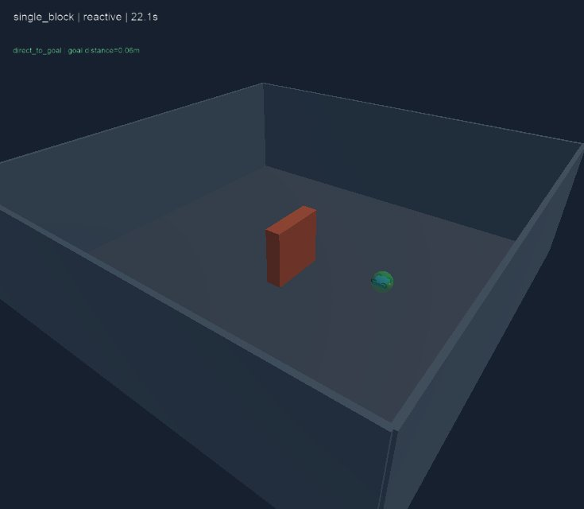

# Điều hướng không camera — chẩn đoán v1, 2026-10-26

Đã chạy hai baseline không học trên Webots R2025a thật. Reactive hoàn thành ba fixture khả thi; direct hoàn thành ca trống và va chạm ở hai ca có vật cản. Đây là bằng chứng tích hợp và năng lực đi vòng trong các fixture công khai, chưa phải benchmark tổng quát hoặc kết quả học máy.

## Nguồn và tái hiện

- Source commit: cda58590a23471a7738fe1a09332ffb0cc0f9e71.
- [CI run 40249783714](https://github.com/NguyenPhan161206/Game_Simulator_Lap-Blind_Drone/actions/runs/40249783714), job simulator 121338946113, kết luận success.
- [Kết quả JSON đầy đủ](2026-10-26-navigation-v1.json) được lấy từ EVIDENCE_JSON result.json của đúng job trên qua GitHub connector; không tự tạo số đo từ unit test.
- [Artifact chứa telemetry và ảnh từng lượt](https://github.com/NguyenPhan161206/Game_Simulator_Lap-Blind_Drone/actions/runs/40249783714/artifacts/12619804327). Telemetry ghi thưa khoảng 64 ms; scoring chạy mỗi 16 ms.
- Ubuntu 22.04, Python 3.12, Xvfb/software OpenGL. Cấu hình và SHA256 specification nằm trong JSON; WorldInfo randomSeed 11. Từng case chạy một lần mỗi phương pháp, cùng start/goal/geometry, reset giữa lượt; không phải nhiều seed độc lập.
- 29 unit test đạt, smoke môi trường cũ đạt 12/12 mục; năm gate tích hợp navigation đạt. Không chấm direct đâm vật cản thành lỗi infrastructure: đó là outcome cần ghi nhận.

Tái hiện khi có Webots R2025a:

```bash
make check
python3 tools/run_webots.py --smoke
python3 tools/run_webots.py --navigation
```

## Tất cả tám lượt

| Tình huống | Phương pháp | Outcome | Thời gian (s) | Quãng đường (m) | Khoảng cách cuối (m) |
|---|---|---|---:|---:|---:|
| Trống | direct | success | 18.064 | 8.958 | 0.057 |
| Trống | reactive | success | 18.048 | 8.943 | 0.057 |
| Một khối chắn | direct | collision | 6.528 | 3.300 | 5.700 |
| Một khối chắn | reactive | success | 22.064 | 11.192 | 0.057 |
| Hai khối lệch nhau | direct | collision | 5.616 | 2.800 | 6.200 |
| Hai khối lệch nhau | reactive | success | 28.560 | 14.838 | 0.057 |
| Đích trong khối, không khả thi | direct | collision | 5.440 | 2.704 | 1.296 |
| Đích trong khối, không khả thi | reactive | timeout | 65.008 | 35.926 | 2.500 |

Ba ca khả thi: direct 1/3 thành công, hai collision; reactive 3/3 thành công, zero collision được ghi nhận. Thời gian/quãng đường trung bình **chỉ trên lượt thành công** lần lượt là direct 18.064 s/8.958 m và reactive 22.891 s/11.658 m. Hai trung bình này đến từ các tập lượt thành công khác nhau, không chứng minh direct nhanh hơn trên cùng nhiệm vụ hoàn thành.

Đối chứng âm được báo riêng: không phương pháp nào được chấm success. Reactive vẫn di chuyển tới hết giờ, chưa có năng lực xác định đích không thể tới hoặc tự từ bỏ sớm. Timeout ở 65.008 s là lần lấy mẫu đầu tiên sau 65 s; evaluator không cho thành công sau deadline.

## Hiển thị và ranh giới đầu vào

Đã xem ảnh cuối single_block/reactive: world có một khối chắn, drone nằm trong vùng đích, nhãn 22.1 s. Ảnh chỉ xác nhận hiển thị/trạng thái cuối; không là toàn bộ đường bay hoặc đầu vào navigation.



Drone là Robot thường, không phải Supervisor. Code navigation chỉ nhận NavigationObservation và NavigationMission; mission không có case ID/feasibility, vật cản hay waypoint. Supervisor chỉ thay world/reset trước lượt và chấm ground truth, không gửi motion trong lượt. Không có thiết bị ảnh trong PROTO; ảnh observer do supervisor xuất.

## Giới hạn và kết luận sử dụng

- Bộ fixture nhỏ và đã dùng phát triển; không kết luận tỷ lệ thành công trên môi trường chưa thấy, không có khoảng tin cậy hoặc nhiều seed.
- Đích/start cố định cùng độ cao, yaw ban đầu zero; tránh chủ yếu theo mặt phẳng ngang. Chưa thử concave/U, lối hẹp, góc/yaw/start ngẫu nhiên hoặc lựa chọn bay qua/trên/dưới.
- Phép đo và định vị lý tưởng; ray thưa có điểm mù. Hộp thân là collision hull, không tính va chạm rotor. Chưa có mô hình radar vật lý, sai số định vị, gió/pin hoặc hardware.
- Chưa giảm cảm biến/dữ liệu, huấn luyện ANN/RL, so sánh camera-teacher hay đo quyền riêng tư. Không dùng camera không tự bảo đảm bảo mật.
- Local vẫn thiếu Webots và shell không tải được; không tuyên bố đã cài/chạy GUI hoặc bấm phím trên máy local.

Mốc baseline/evaluator cơ bản đạt trên CI. Bước nghiên cứu tiếp theo nên là tạo bộ tình huống đa dạng có seed và phân chia tập rõ, mở rộng tình huống thất bại của baseline rồi khóa protocol trước huấn luyện/khảo sát giảm dữ liệu.
