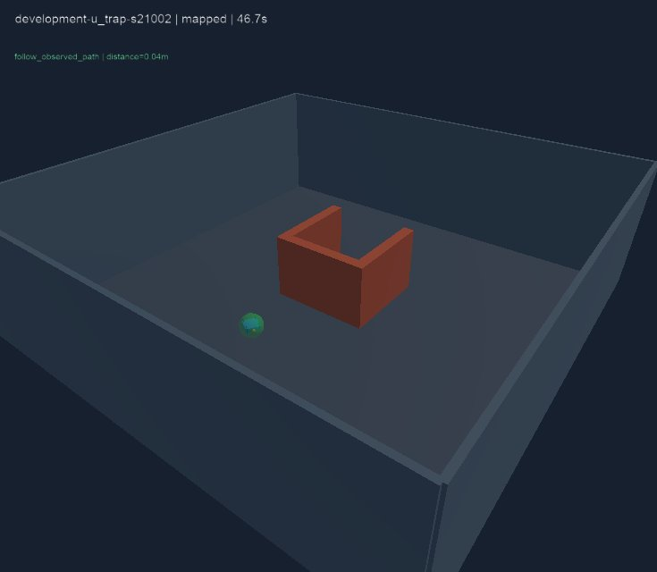

# Hoàn tất giai đoạn 0005 — quan sát và điều hướng v2

Ngày: 2026-10-26. Hai phương án guarded/mapped vượt qua các ca chữ U gây lỗi reactive trong tập phát triển và hoàn thành mọi ca khả thi của validation/test mới. Đây là kết quả mô phỏng hữu hạn, không là bảo đảm an toàn hoặc kết quả huấn luyện model.

## Nguồn và protocol

- [CI chính thức 40255492790](https://github.com/NguyenPhan161206/Game_Simulator_Lap-Blind_Drone/actions/runs/40255492790), job 121356328160, success; source 2f422e253376b589e478ac10f3eee8efa970dc74.
- [Evidence JSON](2026-10-26-navigation-v2.json) giữ ba result, study, các trace/failure review nguyên số từ log đúng job. Đã chạy lại integrity checker trên JSON trích xuất, không gọi đó là simulator local.
- [Artifact raw](https://github.com/NguyenPhan161206/Game_Simulator_Lap-Blind_Drone/actions/runs/40255492790/artifacts/12621809930): telemetry, trajectories, cases, failures. File lớn không commit.
- V2 lock: 0825b3b219fbf6a7f939b3076b79b1c82888c02d71a8ffea36d2e7d5bde1e395; manifest: 14ea5519eea62321c66c21d752834d94e6a9ff08ed189e9a23c9b93430b8477f. V1 lock vẫn giữ nguyên.
- Ubuntu 22.04, Python 3.12, Webots R2025a/Xvfb/software OpenGL; 64 unit test đạt. Toàn bộ lượt chính thức không rendering, không xuất ảnh từ các lượt này. Cả ba split cùng source/lock/manifest, working_tree_dirty=false.

Ba pilot development có 36 lượt mỗi đợt được giữ riêng trong [development evidence](2026-10-26-v2-development.json) và [chẩn đoán](2026-10-26-v2-diagnostics.md). Không cộng các lần lặp này thành mẫu test độc lập. Source 69d6712 đạt tiêu chí development sau sửa recovery, rồi mới khóa. CI chính thức kiểm tra lại tiêu chí development trước khi mở validation/test; không chỉnh runtime sau khi thấy fresh results.

## Đã triển khai

- Chiếu ray bằng RPY/pose đo được; grid free/occupied/unknown, giới hạn vùng và cell budget, không nhận map thật.
- Guard trên điểm đã đo, xét hull sphere và khoảng đáp ứng phanh quy ước; quét yaw để cập nhật giữa các hướng ray.
- Mapped dùng A* trên grid tự đo, chỉ thực thi đoạn đã quan sát và kiểm tra recovery khi ô hiện tại mới bị inflate. Không có waypoint/witness/oracle của supervisor trong input.
- V2 adapter/world/launcher/protocol riêng, không sửa file v1 đã khóa; snapshot failure tách public observation với ground truth dùng chấm.
- So sánh reactive nguyên v1 với guarded và mapped. Quét, tốc độ và biểu diễn khác nhau giữa gói; không quy toàn bộ cải thiện cho riêng bộ nhớ hoặc A*.

Ranh giới trên được kiểm tra theo input và code path, không là sandbox OS: controller kế thừa environment launcher chứa metadata thí nghiệm; navigation class không đọc hoặc nhận metadata đó qua observation/mission. Chưa xây cách ly quyền truy cập cho policy không đáng tin cậy.

## 108 lượt chính thức

Mỗi split có 12 case (10 khả thi + 2 goal trong solid), ba policy. Development tái dùng seed 21001/21002 đã exposed; validation mới 51001/51002 và test mới 61001/61002. Cùng family generator giữa các split, chưa phải môi trường ngoài phân phối. Mỗi case/policy chạy một lần, không phải nhiều seed huấn luyện.

| Split, ca khả thi | Reactive thành công / collision | Guarded thành công / collision | Mapped thành công / collision |
|---|---|---|---|
| Development, 10 ca | 8/10 · 2 | 10/10 · 0 | 10/10 · 0 |
| Validation, 10 ca | 8/10 · 2 | 10/10 · 0 | 10/10 · 0 |
| Test, 10 ca | 8/10 · 2 | 10/10 · 0 | 10/10 · 0 |

Hai reactive collision ở mỗi split đều thuộc U; guarded/mapped hoàn thành cả hai U của mỗi split. Các family khả thi khác hoàn thành ở cả ba policy trong đợt này. Không có timeout/out_of_bounds trong nhóm khả thi. Mỗi policy có sáu negative control trên ba split: cả sáu timeout, không false success. Chưa biết nhận diện vô nghiệm hoặc từ bỏ sớm.

Pose/yaw đầu là cùng spec, reset và warmup 2 s, với sai số đầu cho phép ≤0.18 m/≤0.1 rad; giá trị thực được ghi trong từng episode. Không giả định trạng thái động cơ giữa các lượt là bản sao vật lý hoàn toàn giống nhau.

## Hiệu quả và chi phí trên test

| Policy | Time trung bình chỉ success (s) | Path trung bình chỉ success (m) | CPU mean / max (ms) | Primary cells tối đa |
|---|---:|---:|---:|---:|
| Reactive | 26.984, n=8 | 13.853, n=8 | 0.068 / 0.142 | 0 |
| Guarded | 41.184, n=10 | 14.380, n=10 | 0.580 / 2.580 | 5221 |
| Mapped | 37.619, n=10 | 13.340, n=10 | 0.744 / 52.768 | 5185 |

Guarded/mapped success trên cùng mười case, nên hai mean đó có cùng tập nhiệm vụ; mapped ít time/path hơn guarded trong tập này. Reactive chỉ có tám success và giới hạn 0.55 m/s thay vì 0.4 m/s, không so mean của nó như cùng tập hoặc cùng tốc độ.

CPU mean được trọng số theo decisions trên **cả 12 lượt test** mỗi policy, kể cả negative controls; CPU max là quyết định đơn lẻ chậm nhất. Max mapped trên toàn đợt là 55.957 ms, lớn hơn physics tick 16 ms. Webots chờ controller theo thời gian mô phỏng; chưa xác nhận deadline điều khiển thời gian thực trên phần cứng.

Max primary trên mọi split: guarded 5277, mapped 5378; budget 16000 không bị hết. Derived blocked cells được báo riêng (mapped tối đa 2257). Đây là số cell, không phải byte/RSS của Python. Reactive vẫn nhận range/pose mặc dù map cells=0.

Test nhận tổng range scalar values: reactive 133540, guarded 184990, mapped 173840, trên 12 lượt có thời lượng khác nhau. Mọi cấu hình vẫn bật 10 ray mỗi 32 ms; số tổng khác chủ yếu theo thời gian nhiệm vụ/outcome. Chưa giảm cảm biến, sampling hoặc byte truyền/lưu; map có thể biểu diễn bố trí không gian và không tự bảo đảm riêng tư.

## Hiển thị và chạy thử

Đã xem ảnh pilot 1: development U seed 21002, mapped tới đích ở 46.7 s. Ảnh dưới có source 5d1500b, là observer của pilot có rendering; không giả làm ảnh validation/test hoặc ảnh local. Các trường outcome/time/path/pose cuối của 36 episode giống nhau giữa ba pilot, nhưng recovery được kiểm tra riêng bằng contract fixture, không tuyên bố nó tăng success Webots từ những case này.



```bash
python3 tools/run_navigation_v2.py --policy mapped --case development-u_trap-s21001 --realtime
```

Xem [hướng dẫn v2](../navigation-v2.md). Local Webots đã tải và ldd không thiếu dependency tại lúc audit, nhưng phiên managed không kết nối được display :0; chưa xác nhận GUI/flight local. Các lần kiểm chứng bay ở báo cáo này là Webots CI thật.

## Quyết định và việc còn lại

Giai đoạn 0005 đạt mục tiêu kỹ thuật đã đặt trước, có kết quả fresh sau khóa, integrity và tài liệu tái hiện. Guarded/mapped là reference không học có triển vọng trong miền thử nghiệm này, không phải thuật toán an toàn tổng quát. Không có ANN/RL hoặc kết quả giao hàng/hardware.

Chỉ hai seed mỗi family ở validation/test, cảm biến/định vị lý tưởng, world tĩnh và tránh ngang. Không kết luận cho nhiễu, vật cản động, 3D đa tầng hoặc rotor collision. Narrow-gap vẫn chấm tới đích, chưa có chỉ số bắt buộc xuyên khe; success không chứng minh bay qua đúng khe. Chưa tách riêng ảnh hưởng tốc độ/quét/guard/memory/planner bằng ablation một yếu tố.

V2 validation/test đã được xem. Thay thuật toán tiếp theo phải dùng development và protocol/test mới trước báo chất lượng; các lần chạy lại đúng lock chỉ là regression/reproduction. Bước sau có thể khảo sát giảm biểu diễn lưu/đầu vào hoặc thiết kế thí nghiệm học trên train split riêng. Guarded hiện không dùng free-grid để lập đường, nhưng lợi ích bỏ phần lưu đó cần được đo bằng ablation mới, không tự nhận là đã giảm dữ liệu.
