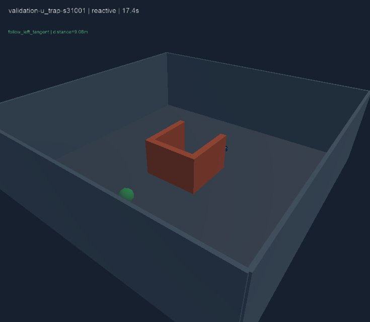
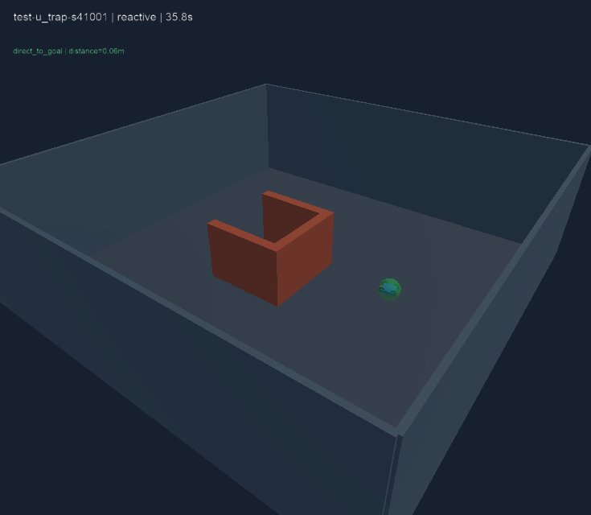

# Môi trường có seed — hoàn tất giai đoạn trước huấn luyện

Ngày: 2026-10-26. Nền môi trường/đánh giá đã chạy đủ theo protocol khóa. Baseline reactive vẫn có lỗi ở chữ U; việc hoàn tất pipeline không đồng nghĩa thuật toán đã đủ vững hoặc đã có model học.

## Nguồn bằng chứng

- Source runtime: 373b002d0ada514c95ce409cbb87d4bc3d68a388, baseline.py giữ nguyên byte so với 555f59f.
- [CI 40251251346](https://github.com/NguyenPhan161206/Game_Simulator_Lap-Blind_Drone/actions/runs/40251251346), job simulator 121343427924, success.
- [Evidence JSON](2026-10-26-seeded-study.json): ba result.json, kết quả tổng hợp và sáu trace review, lấy từ log của đúng job qua GitHub connector; giữ nguyên số đo.
- [Artifact đầy đủ](https://github.com/NguyenPhan161206/Game_Simulator_Lap-Blind_Drone/actions/runs/40251251346/artifacts/12621115818): cases, raw telemetry, trajectories và ảnh từng lượt. Các file raw lớn không commit.
- Protocol SHA256: 96872282fc7df5029453ed684d0e73e9305137c3d6907736869b2e04bf64b90f.
- Manifest SHA256: 46336ca0e8f0fdc7c2d954457c790212e11a1b9f51a956a7ea9624f204bffafe.
- Cả ba split cùng source/manifest/protocol, working_tree_dirty=false. Ubuntu 22.04, Python 3.12, Webots R2025a/Xvfb/software OpenGL. WorldInfo randomSeed 11; seed hình học được ghi riêng theo case.
- 42 unit test đạt trên CI; 12 mục smoke và tám lượt diagnostic cũ đạt điều kiện kiểm tra; 48 lượt seeded và kiểm tra đầy đủ paired study đạt. Sau lần chạy, bổ sung assertion local xác nhận toàn bộ goal ball của mỗi ca âm nằm trong solid; không đổi runtime/protocol hoặc số đo.

## Đã hoàn thành những gì

36 case tái lập thuộc sáu family và bốn split, không trùng seed/geometry fingerprint. Mỗi ca khả thi có witness ngang bảo thủ; ca âm đặt toàn bộ goal ball trong khối. Train_reserved có 12 case chưa train/chạy đánh giá. Development/validation/test có 24 case, hai policy mỗi case, tổng 48 lượt.

Đã khóa code/config/manifest trước lần chạy seeded đầu, chạy dev → validation → test trong cùng job, không tune giữa các bước và không có lần sửa runtime sau exposure. Supervisor thay geometry/boundingObject và yaw trước lượt, không teleport hoặc gửi route/velocity trong lượt. Drone không nhận ảnh, split/seed/ID, feasibility hay witness.

## Kết quả trên các ca có đường đi

| Split | Direct thành công | Direct collision | Reactive thành công | Reactive collision |
|---|---:|---:|---:|---:|
| Development | 4/10 | 6 | 8/10 | 2 |
| Validation | 2/5 | 3 | 4/5 | 1 |
| Test | 2/5 | 3 | 5/5 | 0 |

Không có timeout hoặc out_of_bounds trên các ca khả thi trong đợt chạy này. Bốn ca âm được báo riêng theo mỗi policy: direct collision cả bốn, reactive timeout cả bốn, không bị chấm success. Reactive chưa nhận biết vô nghiệm hoặc tự từ bỏ sớm.

| Family khả thi | Direct dev/val/test | Reactive dev/val/test |
|---|---|---|
| Empty | 2/2 · 1/1 · 1/1 | 2/2 · 1/1 · 1/1 |
| Single block | 0/2 · 0/1 · 0/1 | 2/2 · 1/1 · 1/1 |
| Staggered blocks | 0/2 · 0/1 · 0/1 | 2/2 · 1/1 · 1/1 |
| Narrow gap | 2/2 · 1/1 · 1/1 | 2/2 · 1/1 · 1/1 |
| U trap có lối thoát | 0/2 · 0/1 · 0/1 | 0/2 · 0/1 · 1/1 |

Ba reactive collision đều thuộc U: seed 21001 ở 13.936 s, seed 21002 ở 13.488 s, seed 31001 ở 17.360 s. Test U seed 41001 hoàn thành ở 35.824 s. Đây là khác biệt đáng kể giữa các biến thể, không được che bằng test 5/5. Chưa làm ablation để xác định riêng tác động của yaw, geometry, ray thưa hoặc logic tiếp tuyến.

## Thành công không đồng nghĩa đi qua khe hẹp

Đã đọc ba trace reactive narrow_gap, chọn một case mỗi split. Chúng cắt mặt phẳng giữa hai khối ở độ lệch khoảng 6 m so với tâm khe, trong khi khe chỉ rộng khoảng 1.54–1.70 m. Dấu vết lấy thưa cho thấy đi vòng ngoài. Vì vậy các lượt này chứng minh tới đích trong world có khe, chưa chứng minh reactive chui qua khe.

Ở cùng test narrow_gap, direct đi 10.499 m trong 20.880 s; reactive đi 18.543 m trong 35.696 s. Không gọi reactive tối ưu hoặc nhanh hơn chỉ từ tỷ lệ hoàn thành. Các mean success-only trong JSON có mẫu thành công khác nhau giữa policy, không so sánh trực tiếp như cùng tập nhiệm vụ.

## Rà soát hiển thị

Đã xem ảnh observer U của cả ba split: geometry và nhãn khớp case/seed. Hai ảnh dưới là validation lúc collision và test lúc success. Drone có thể bị solid che trong observer; kết luận collision dựa vào contact vật lý/episode result, không dựa riêng vào ảnh. Ảnh không là input của drone.

## Quyết định bàn giao và giới hạn

Đạt mốc môi trường/đánh giá trước huấn luyện: có generator, witness, split/lock, runner, kiểm tra integrity, số đo và tài liệu tái hiện. Chưa đạt kết luận navigation an toàn/tổng quát; chưa có threshold chất lượng sản phẩm, ML, khảo sát giảm cảm biến hoặc bảo vệ thông tin đã được đo.

Test chỉ một seed/family, cùng family generator với development; không đủ kết luận tỷ lệ thành công tổng quát. Test v1 đã được xem, cần xem nó là exposed khi thay thuật toán. Bản tiếp theo phải khóa protocol mới và test chưa dùng trước khi báo chất lượng mới; không chỉ tune trên ba U collision rồi dùng lại test v1 như unseen.

Mô hình còn lý tưởng, điều hướng ngang, không có rotor collision, định vị nhiễu/gió hoặc radar vật lý. Local chưa cài/chạy GUI Webots trong phiên; lệnh chạy được hướng dẫn ở [seeded suite](../seeded-environments-v1.md) và [lab v1](../lab-v1.md).

Bước kế tiếp nên phân tích U collision, thiết kế biểu diễn quan sát/lịch sử và bộ lọc chuyển động xét hull trên tập phát triển, rồi đặc tả thí nghiệm học với protocol/test mới. Không tự chuyển sang train chỉ vì pipeline đã đạt.
