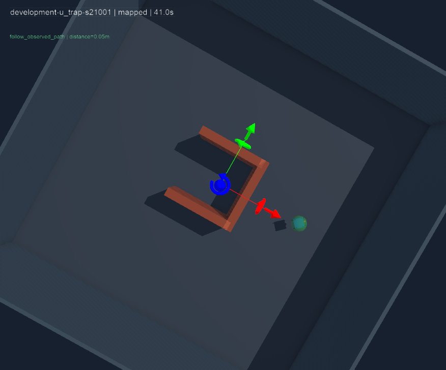

# Hoàn tất nghiệm thu local — nhánh L

Ngày 2026-10-27. **LOC-01…LOC-09 hoàn tất đúng phạm vi chạy/thao tác trên laptop.** Hai lượt cuối cùng dùng source **39c34af875b66ff51f6797ba0872c084b5a3928d**, working_tree_dirty=false, Webots R2025a và cùng helper/binary hash. [JSON evidence](2026-10-27-local-acceptance-complete.json) giữ session, phiếu, result, số đo, delta và SHA256 raw files.

Người dùng thao tác GUI và trả lời phiếu; agent kiểm tra file, xem ảnh và đối chiếu dữ liệu. Đây là hai lượt chạy riêng được review cùng nhau, không tạo lại hoặc sao chép phiếu thành một batch giả.

## Manual — LOC-05

Lượt artifacts/local-manual-20261027T020953592943Z: minimal_lab.wbt, drone_controller/lab_supervisor, exit 0, kết thúc bình thường sau 114.470619 s wall. Có 1691 telemetry packet, t=0.016…108.816 s, không dòng lỗi. Phiếu xác nhận GUI/world-controller, các phím, SPACE/thả phím/R đều yes; phản hồi smooth, không pause/đổi speed. Review không còn manual_evidence_warnings.

| Trục lệnh | Min / max | Mẫu dương / âm |
|---|---:|---:|
| Tiến/lùi (m/s) | -0.8 / +0.8 | 354 / 165 |
| Trái/phải (m/s) | -0.8 / +0.8 | 205 / 199 |
| Lên/xuống (m/s) | -0.4 / +0.4 | 391 / 205 |
| Yaw (rad/s) | -0.5 / +0.5 | 35 / 15 |

Đã có T/G trong telemetry và thay đổi độ cao thực, khắc phục phần bằng chứng còn thiếu ở các lượt trước. Source giữ nguyên 39c34af giữa lượt thiếu và lượt đủ T/G; không sửa mapping để làm lượt này đạt. Nguyên nhân mất/thiếu sự kiện ở các lượt trước chưa được xác định bằng raw key trace.

SPACE/thả phím/R được người thao tác xác nhận; sampled command không tự phân biệt từng phím vật lý hoặc số lần reset. Không biến unit mapping test thành bằng chứng đã nhấn phím.

Manual ghi z=1.353973…5.282923 m. Giới hạn target altitude 5 m trong bộ điều khiển không là rào vật lý tuyệt đối; có overshoot được giữ nguyên trong evidence. Nghiệm thu thao tác không chứng nhận ổn định/an toàn phần cứng.

## Mapped realtime — LOC-06/07

Lượt artifacts/local-mapped-20261027T022316444291Z: observed_v2.wbt, drone_v2/lab_v2, chỉ development-u_trap-s21001/mapped. Exit 0, result và hai integration checks passed, một episode được ghi đúng. Phiếu xác nhận GUI, world/controller, đã thấy chuyển động và kết thúc; smooth, không pause/đổi speed. Manual kết thúc trước mapped; không có overlap.

- Outcome success, contact_count=0.
- Nhiệm vụ 41.216 s; đường đi 14.858754976 m.
- Khoảng cách cuối 0.046151670 m; vận tốc cuối 0.016381393 m/s, nằm trong tiêu chí evaluator đã khóa.
- Cùng case geometry/manifest/protocol với bản v2 khóa; raw cases.json khớp đúng manifest.
- Telemetry timestamps tăng đơn điệu, không dòng lỗi; trajectory nằm trong bounds evaluator. Có result, manifest, cases, trajectory, console, source, phiếu và JPG đúng lượt.

Ảnh được sao chép nguyên byte từ đúng lượt, SHA256 trong JSON; đây là observer cho người xem, không đi vào policy. Đã mở xem ảnh: drone ở gần đích, label khoảng cách khoảng 0.05 m. Numeric result là nguồn thời gian/tiêu chí chính xác hơn label làm tròn.

## Đối chiếu CI và hiệu năng — LOC-08/09

Tham chiếu [CI v2 chính thức 40255492790](https://github.com/NguyenPhan161206/Game_Simulator_Lap-Blind_Drone/actions/runs/40255492790), source 2f422e2. Hai lock vẫn nguyên: v1 96872282fc7df5029453ed684d0e73e9305137c3d6907736869b2e04bf64b90f; v2 0825b3b219fbf6a7f939b3076b79b1c82888c02d71a8ffea36d2e7d5bde1e395.

Cùng success/0 contact và 41.216 s. Path local dài hơn 0.003421004 m; initial pose lệch 0.002156186 m; final pose lệch khoảng 1.02e-8 m. 82 sample trajectory có cùng thời điểm; bốn sample lệch XY tối đa 0.0001 m, XYZ tối đa 0.0022 m ở đầu lượt. Review vẫn gắn numeric_difference_review_required; các delta đã được đọc và giữ, không đổi ngưỡng hoặc quy nguyên nhân cho GPU/round-off.

Các trường outcome/time/path/initial-final pose/distance/speed/contact khớp **chính xác** lượt laptop 20261026T064328483395Z đã audit trước. Sự tái lập này hỗ trợ kết luận không phát hiện regression nhiệm vụ trong ca phát triển đang thử; không chứng minh tương đương từng physics tick hoặc tổng quát sang môi trường khác.

Wall mới 46.774846 s; tỷ số (41.216+2 s warmup)/wall = 0.923915. CPU policy mean 1.057187 ms, max 32.586333 ms; peak map cells 5178/16000, không hết budget. Max CPU vẫn lớn hơn tick 16 ms. Phiếu smooth là quan sát GUI của người dùng; tỷ số gồm startup/shutdown, không đo FPS/input latency hoặc chứng minh deadline điều khiển thời gian thực.

## Kiểm tra và giới hạn bàn giao

Đã chạy lại review/evidence_gaps trên từng lượt: cả hai danh sách gaps rỗng. Đã xác minh hash binary/helper, source sạch, hai protocol, case/manifest/geometry, ngưỡng outcome, raw hashes, thứ tự thời gian và ảnh. Source runtime 39c34af đã qua 82 unit test và cả bốn workflow CI; commit tài liệu sau đó giữ đúng source đã chạy.

LOC-01/02/03 dùng bằng chứng installer, dependency và phiên managed lỗi display đã liên kết trong [checklist](../../CHECKLIST_DU_AN.md). Các lượt cũ timeout/thiếu lệnh vẫn được giữ ở [audit trước](2026-10-27-local-acceptance-followup.md). Các báo cáo lịch sử không được đổi thành lượt đạt.

Phạm vi hoàn tất: GUI/điều khiển local và tái lập một ca navigation development. Test v1/v2 đã exposed; đây là reproduction, không là evaluation unseen mới. Chưa có ANN/RL được huấn luyện, giảm dữ liệu được chứng minh hoặc xác nhận phần cứng. Bước tiếp theo là chốt câu hỏi nghiên cứu/protocol mới ở mục 9 checklist.
