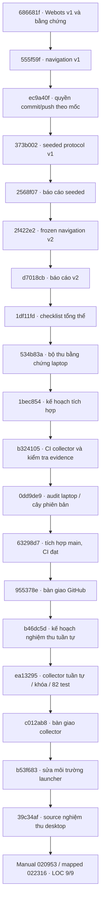

# Cây phiên bản và nguồn kiểm chứng

Snapshot ngày 2026-10-27. Repo: [Game_Simulator_Lap-Blind_Drone](https://github.com/NguyenPhan161206/Game_Simulator_Lap-Blind_Drone). Có thể xem [commit graph trên GitHub](https://github.com/NguyenPhan161206/Game_Simulator_Lap-Blind_Drone/network) và dùng `bash tools/git.sh log --all --graph --decorate --oneline` trong workspace này.

## Lịch sử các mốc

Sơ đồ sau biểu diễn các mốc nối tiếp trong lịch sử đang dùng; không giả định đây là các nhánh phát triển độc lập hoặc merge commit.

| Nhánh/mốc | Tip được đồng bộ hoặc source kiểm chứng | Ý nghĩa |
|---|---|---|
| feat/webots-lab-v1 | 686681fc1391cc503dd07ee85ce1df78d34f7dd5 | Bản lab lịch sử |
| feat/navigation-v1 | 555f59fd856f73a3f44018ce334c0faa2ef7c0b6 | Baseline và báo cáo |
| feat/seeded-environments | 2568f0771c5e591df0089ed3ce2f272637928b64 | Tip tài liệu đã đồng bộ fast-forward từ source chạy 373b002 |
| feat/navigation-v2 | d7018cb187e6ce9268baa34a5e2fd6f7ab200078 | Tip tài liệu đã đồng bộ fast-forward từ source chạy 2f422e2 |
| feat/local-acceptance | Runtime gần nhất 39c34af875b66ff51f6797ba0872c084b5a3928d và commit tài liệu sau đó | Collector, launcher và nghiệm thu local đã có bằng chứng |
| main | Source nghiệm thu 39c34af, có commit tài liệu bàn giao sau đó | Cả bốn CI tại source này đạt; tip hiện tại xem GitHub/log |

Nhánh lịch sử không bị xóa hoặc force-push. Source chạy và commit tài liệu khác nhau là có chủ ý; mỗi báo cáo giữ SHA đã chạy. Bảng là snapshot có ngày, không là cơ chế tự động theo dõi remote.

## Evidence và điều kiện tích hợp

- [Navigation v2: 108 lượt chính thức](research/2026-10-26-navigation-v2.md), source 2f422e2; test đã exposed.
- [Audit laptop](research/2026-10-26-local-acceptance.md), source lượt chạy 534b83a; LOC-04/07/08 có bằng chứng, LOC-05/06/09 chờ bổ sung.
- [CI collector 40284088405](https://github.com/NguyenPhan161206/Game_Simulator_Lap-Blind_Drone/actions/runs/40284088405), source b324105, 75 unit test và hai lượt Webots thật: mapped success, manual telemetry/timeout. [JSON evidence](research/2026-10-26-local-collector-ci.json). Đây là Xvfb, không xác nhận phím laptop.
- [Kế hoạch và checklist tích hợp](plans/0007-github-integration.md) phân biệt commit kế hoạch, công cụ, kết quả CI và handoff; mỗi mốc phải qua check phù hợp trước push/tích hợp.
- [Bàn giao tích hợp main](research/2026-10-26-github-integration.md) có bốn workflow đạt tại source 63298d7, gồm 75 unit test và hồi quy Webots v1/v2; ba gate desktop còn thiếu vẫn giữ mở.
- [Nghiệm thu tuần tự](research/2026-10-26-sequential-acceptance.md) tại ea13295 có 82 test và CI kiểm tra mapped/manual/khóa chống chạy chồng; tiếp tục giữ gate desktop riêng.
- [Hoàn tất local](research/2026-10-27-local-acceptance-complete.md) tại source 39c34af: manual đủ bốn trục/T/G, mapped success và phiếu phù hợp; LOC-01…09 hoàn tất. Các giới hạn realtime/mô phỏng vẫn được giữ.

Trong workspace managed dùng `tools/git.sh` vì .git gốc chỉ đọc và là metadata rỗng; lịch sử có thật nằm ở .local/git. Clone bình thường dùng .git chuẩn. SSH managed hiện lỗi quyền cấu hình hệ thống; connector GitHub dùng làm kênh xuất bản được cho phép, kiểm tra khớp tree/commit và không đổi remote SSH. Xem [hướng dẫn Git](development.md).

## Mốc 6 — thiết kế nghiên cứu v3, 2026-10-27

Nhánh `feat/research-protocol-v3`: kế hoạch `a85e41b` → thiết kế/công cụ khóa `761318df1293c195347f486b0d228f88af10fae1` → tài liệu bàn giao sau đó. [CI 40446508423](https://github.com/NguyenPhan161206/Game_Simulator_Lap-Blind_Drone/actions/runs/40446508423) chạy make check, đủ 92 tests và kiểm 480 case. [Báo cáo](research/2026-10-27-research-protocol-v3.md) phân biệt design lock với runtime lock chưa có. Không sửa frozen v1/v2 hoặc bổ sung outcome v3. Main chỉ fast-forward sau các checks liên quan; đây là snapshot source kiểm chứng, tip xem GitHub/log.

## Mốc 7A — runtime cadence v3, 2026-10-28

Nhánh `feat/range-cadence-v3-runtime`: kế hoạch `f9fa972` → runtime `0c75ce28f14b8ea881e8c0c7c9335aa4319030c5` → artifact khóa và bàn giao sau đó. [CI 40615141669](https://github.com/NguyenPhan161206/Game_Simulator_Lap-Blind_Drone/actions/runs/40615141669) đạt 112 tests và đủ 240 lượt development; local có 240 lượt riêng cùng source sạch. [Báo cáo](research/2026-10-28-cadence-v3-development.md) ghi acquisition/accounting, source lock và giới hạn: reference 45/50, candidate 46/50, chưa đạt success 95%; v3 validation/test chưa chạy. Khóa runtime bổ sung không thay design/v1/v2 locks. Bàn giao thêm các tests fault injection, tổng 116 unit tests.

Trong phiên laptop này, normal SSH trong sandbox vẫn bị lỗi quyền cấu hình hệ thống; fetch/push SSH ngoài sandbox đã thành công theo approval và standing authorization. Không đổi remote hoặc quyền metadata để xử lý lỗi đó. Main/nhánh feature chỉ được đồng bộ theo các checks tương ứng, không tự coi tip là source đã chạy.
