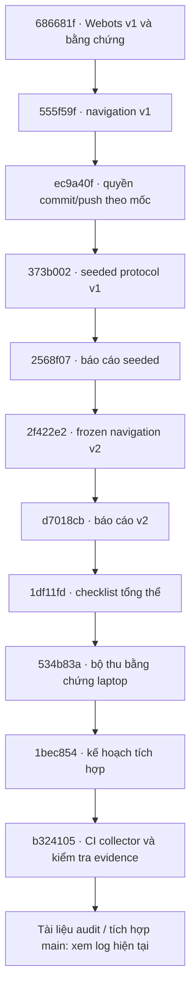

# Cây phiên bản và nguồn kiểm chứng

Snapshot ngày 2026-10-26. Repo: [Game_Simulator_Lap-Blind_Drone](https://github.com/NguyenPhan161206/Game_Simulator_Lap-Blind_Drone). Có thể xem [commit graph trên GitHub](https://github.com/NguyenPhan161206/Game_Simulator_Lap-Blind_Drone/network) và dùng `bash tools/git.sh log --all --graph --decorate --oneline` trong workspace này.

## Lịch sử các mốc

Sơ đồ sau biểu diễn các mốc nối tiếp trong lịch sử đang dùng; không giả định đây là các nhánh phát triển độc lập hoặc merge commit.

| Nhánh/mốc | Tip được đồng bộ hoặc source kiểm chứng | Ý nghĩa |
|---|---|---|
| feat/webots-lab-v1 | 686681fc1391cc503dd07ee85ce1df78d34f7dd5 | Bản lab lịch sử |
| feat/navigation-v1 | 555f59fd856f73a3f44018ce334c0faa2ef7c0b6 | Baseline và báo cáo |
| feat/seeded-environments | 2568f0771c5e591df0089ed3ce2f272637928b64 | Tip tài liệu đã đồng bộ fast-forward từ source chạy 373b002 |
| feat/navigation-v2 | d7018cb187e6ce9268baa34a5e2fd6f7ab200078 | Tip tài liệu đã đồng bộ fast-forward từ source chạy 2f422e2 |
| feat/local-acceptance | b32410595b26f8ef2d0f8d99dca469797278366b và commit tài liệu sau đó | Collector đã kiểm chứng CI; trạng thái desktop còn gate riêng |
| main | 1df11fd tại lúc bắt đầu; chỉ fast-forward sau check | Nguồn tích hợp; tip hiện tại xem GitHub/log, không coi bảng snapshot là realtime |

Nhánh lịch sử không bị xóa hoặc force-push. Source chạy và commit tài liệu khác nhau là có chủ ý; mỗi báo cáo giữ SHA đã chạy. Bảng là snapshot có ngày, không là cơ chế tự động theo dõi remote.

## Evidence và điều kiện tích hợp

- [Navigation v2: 108 lượt chính thức](research/2026-10-26-navigation-v2.md), source 2f422e2; test đã exposed.
- [Audit laptop](research/2026-10-26-local-acceptance.md), source lượt chạy 534b83a; LOC-04/07/08 có bằng chứng, LOC-05/06/09 chờ bổ sung.
- [CI collector 40284088405](https://github.com/NguyenPhan161206/Game_Simulator_Lap-Blind_Drone/actions/runs/40284088405), source b324105, 75 unit test và hai lượt Webots thật: mapped success, manual telemetry/timeout. [JSON evidence](research/2026-10-26-local-collector-ci.json). Đây là Xvfb, không xác nhận phím laptop.
- [Kế hoạch và checklist tích hợp](plans/0007-github-integration.md) phân biệt commit kế hoạch, công cụ, kết quả CI và handoff; mỗi mốc phải qua check phù hợp trước push/tích hợp.

Trong workspace managed dùng `tools/git.sh` vì .git gốc chỉ đọc và là metadata rỗng; lịch sử có thật nằm ở .local/git. Clone bình thường dùng .git chuẩn. SSH managed hiện lỗi quyền cấu hình hệ thống; connector GitHub dùng làm kênh xuất bản được cho phép, kiểm tra khớp tree/commit và không đổi remote SSH. Xem [hướng dẫn Git](development.md).
